# Database Schema

SQLite, managed by SQLAlchemy 2.0 and Alembic. The authoritative definition is
`backend/models.py`; the migration that creates it is
`backend/migrations/versions/0001_baseline.py`. This document describes both,
and `backend/tests/test_migrations.py` fails if they drift apart.

> **This document previously described a different schema.** It listed a single
> `users` table holding all three roles plus a `documents` table. Neither
> exists: accounts were split into `users` / `doctors` / `admin_users`, and
> documents were never implemented. The content below reflects the real
> database as of the baseline migration.

## Migrations

Schema changes go through Alembic. Nothing else.

```bash
cd backend
alembic revision --autogenerate -m "describe the change"
alembic upgrade head
```

Loaders and seeders live in `backend/scripts/` and are not migrations — see
`backend/scripts/README.md`.

The history starts from a single squashed baseline (`0001_baseline`) rather than
a long linear chain. The earlier five-revision chain had an empty initial
revision and never described the real database, so replaying it on an empty file
produced a schema missing most of the application's tables.
`tests/test_migrations.py` verifies that `alembic upgrade head` and
`Base.metadata.create_all` now produce identical tables and indexes.

| Revision | Change |
| :--- | :--- |
| `0001_baseline` | Squashed baseline. All 11 tables. |
| `0002_check_constraints` | Seven CHECK constraints across `doctors`, `users`, `appointments`, `contact_messages`. |
| `0003_doctors_specialization_fk` | FK `doctors.specialization` → `specializations.name`, `ON DELETE RESTRICT`. |
| `0004_doctors_verified_active_city_idx` | Composite index `doctors (is_verified, is_active, practice_city)`. |
| `0005_updated_at` | `updated_at` on the seven mutable tables, plus `created_at` and `updated_at` on `appointments`. |
| `0006_autoincrement` | `AUTOINCREMENT` on every surrogate primary key. Closes an account-takeover hole — see below. |

Migrations `0002` onward rebuild tables via `batch_alter_table`, because SQLite
has no `ALTER TABLE ... ADD CONSTRAINT`. They commit before
`PRAGMA foreign_keys=OFF`, which is a no-op inside a transaction.

## Scale assumptions

Two places rank in memory rather than in SQL. Both are fine at the platform's
current size, and both are stated here rather than left for a reader to
discover.

### Doctor search — `services/doctor_search.py`

`find_doctors` loads every matching row for the city, then applies a
per-specialty cap of 3 and an overall cap of 8 in Python. The cost is therefore
linear in rows *matched*, not rows returned.

- Fine below roughly 10,000 doctors.
- Past that, move the caps into the query and add a bounding-box prefilter on
  `practice_lat`/`practice_lng`. The interface does not need to change.

The deduplication and the haversine ordering stay in Python either way; both are
clearer here than in SQL.

### The background map — `GET /api/doctors`

Returns every verified, active doctor, unfiltered by city, because the client
places all markers then filters. O(n) in the doctor count, and the first
endpoint to need a bounding box if the platform grows.

### Symptom routing — `services/routing.py`

`build_condition_index` loads the whole `condition_symptoms` table into memory at
startup. The IDF scoring itself is O(distinct symptoms in the request), not O(n)
— the table is only read once, at warm time.

## Vocabulary loading

The symptom and city vocabularies live in `services/vocabulary.py` and are
built by an explicit `warm_all()` call from the FastAPI lifespan handler.

Nothing reads the database at import time. That is deliberate: importing
`nlp_processor` used to open a connection from module scope, which broke a
read-only replica, a worker process starting before migrations, and the test
suite — none of which raise an error, all of which fail quietly.

A caller that reaches the extraction path without warming first gets an empty
vocabulary and a logged warning, degrading to "General Physician" rather than
an import-time failure. `ensure_loaded()` rebuilds on demand.

## Runtime configuration

Set in the `connect` event listener in `backend/database.py`, applied to every
connection the pool hands out:

| Pragma | Value | Why |
| :--- | :--- | :--- |
| `journal_mode` | WAL | Readers no longer block on a writer. Persistent on the file. |
| `synchronous` | NORMAL | Survives an application crash. FULL fsyncs on every commit and is the single largest source of write latency. |
| `busy_timeout` | 5000 ms | Waits out short write contention instead of raising "database is locked". |
| `foreign_keys` | ON | SQLite disables this by default, per connection. Without it the foreign keys below are documentation only. |
| `cache_size` | -64000 (~64 MB) | Keeps hot pages resident. |
| `mmap_size` | 256 MB | Read pages through the OS page cache. |
| `auto_vacuum` | INCREMENTAL | Reclaims space after bulk deletes without a full table lock. Required a one-time `VACUUM` to take effect. |

`PRAGMA foreign_keys=ON` in particular is load-bearing: it is enforced by the
application, not by the schema, so any tool that opens the file without going
through `database.py` — the `sqlite3` CLI, a raw script — will not honour the
foreign keys.

### Transaction modes

SQLAlchemy opens every transaction as `BEGIN DEFERRED`, except where a route
opts into `BEGIN IMMEDIATE` via `begin_immediate(db)`. Deferred is right for
reads and for write-only work. It is wrong for read-then-write: such a
transaction holds a read lock and only asks for a write lock at commit, so two
of them can deadlock, each waiting on the other for up to `busy_timeout`.

Two routes are read-then-write and therefore use IMMEDIATE:

- `POST /api/appointments` — validates the doctor, checks both double-booking
  guards, then inserts
- `PATCH /api/appointments/{id}/cancel` — checks the status before changing it

The request applies to one transaction only and is cleared once consumed, so a
pooled connection never carries it into its next use.

### Maintenance

WAL leaves committed pages in the `medical_app.db-wal` sidecar until a
checkpoint runs, so the `.db` file alone is not a complete snapshot. The FastAPI
lifespan checkpoints with `PASSIVE` on shutdown — not `TRUNCATE`, which needs
exclusive access and blocks for the full `busy_timeout` whenever any request
still holds a read snapshot.

```bash
python scripts/backup_db.py      # consistent snapshot via the backup API
python scripts/maintenance.py    # checkpoint + incremental vacuum
```

## Entity-Relationship Diagram

```mermaid
erDiagram
    USERS ||--o{ APPOINTMENTS : "books"
    DOCTORS ||--o{ APPOINTMENTS : "conducts"
    USERS ||--|| PATIENT_SETTINGS : "preferences"

    USERS {
        Integer id PK
        String email "UNIQUE, INDEX"
        String hashed_password
        String full_name
        Integer age "Nullable"
        String gender "Nullable"
        String phone "Nullable"
        String home_city "Nullable"
        String home_address "Nullable"
        Float home_lat "Nullable"
        Float home_lng "Nullable"
        String reset_token "INDEX, Nullable"
        DateTime reset_token_expires "Nullable"
        Integer reset_failed_attempts "DEFAULT 0"
        Integer token_version "DEFAULT 0"
        DateTime created_at
    }

    DOCTORS {
        Integer id PK
        String email "UNIQUE, INDEX"
        String hashed_password
        String full_name
        String specialization
        Integer experience_years
        String qualifications
        String license_number "UNIQUE"
        String phone
        String practice_city
        String practice_address
        Float practice_lat "Nullable"
        Float practice_lng "Nullable"
        Float consultation_fee
        String bio "Nullable"
        String shift_start
        String shift_end
        Integer slot_duration_minutes
        JSON blocked_dates "Nullable"
        Boolean is_verified
        Boolean is_active
        String reset_token "INDEX, Nullable"
        DateTime reset_token_expires "Nullable"
        Integer token_version "DEFAULT 0"
        DateTime created_at
    }

    ADMIN_USERS {
        Integer id PK
        String email "UNIQUE, INDEX"
        String hashed_password
        String full_name
        String role "admin | superadmin"
        Boolean is_active
        String reset_token "INDEX, Nullable"
        DateTime reset_token_expires "Nullable"
        Integer token_version "DEFAULT 0"
        DateTime created_at
    }

    APPOINTMENTS {
        Integer id PK
        Integer patient_id FK
        Integer doctor_id FK
        Date appointment_date
        String slot_time
        String symptoms_summary
        String status "Pending | Completed | Cancelled"
        String prescription_notes "Nullable"
    }

    PATIENT_SETTINGS {
        Integer user_id PK,FK
        Boolean appointment_emails "DEFAULT 1"
        DateTime updated_at
    }

    CONTACT_MESSAGES {
        Integer id PK
        String name
        String email "INDEX"
        String message
        String status "new | read"
        DateTime created_at
    }

    SPECIALIZATIONS {
        Integer id PK
        String name "UNIQUE, INDEX"
        String description "Nullable"
        JSON common_conditions "Nullable"
        DateTime created_at
    }

    SYMPTOM_MAPPINGS {
        Integer id PK
        String symptom "UNIQUE, INDEX"
        String specialist
        String urgency
        Boolean is_custom
        String added_by "Nullable"
        DateTime created_at
    }

    CONDITION_SYMPTOMS {
        Integer id PK
        String disease "INDEX"
        String symptom "INDEX"
        String specialist
        String risk_level "Nullable"
        DateTime created_at
    }

    REGIONAL_SYMPTOM_KEYWORDS {
        Integer id PK
        String language "INDEX"
        String regional_term
        String english_canonical
        DateTime created_at
    }

    SYMPTOM_ALIASES {
        Integer id PK
        String alias "UNIQUE, INDEX"
        String canonical
        DateTime created_at
    }
```



## Why accounts are three tables

`users`, `doctors` and `admin_users` hold disjoint columns — a patient has
`age` and `home_lat`, a doctor has `license_number` and `shift_start`, an admin
has `role`. A single table would leave most columns null for most rows and
require a `role` discriminator on every query. The cost is that a shared
concept (`email`, `reset_token`) is repeated three times, and cross-table
uniqueness is enforced in application code rather than by the database —
`email_is_registered()` in `routers/auth.py` checks all three.

## Data Dictionary

### `users`

Patients. One row per registered patient.

| Column | Type | Constraints | Description |
| :--- | :--- | :--- | :--- |
| id | Integer | PK | Auto-increment. |
| email | String | Unique, Not Null, Indexed | Login identifier. |
| hashed_password | String | Not Null | bcrypt hash. |
| full_name | String | Not Null | Display name. |
| age | Integer | Nullable | Medical context. |
| gender | String | Nullable | Free text. |
| phone | String | Nullable | |
| home_city | String | Nullable | Canonicalised via `normalize_city()`. |
| home_address | String | Nullable | |
| home_lat / home_lng | Float | Nullable | Geocoded on profile save. |
| reset_token | String | Nullable, Indexed | Link token or hashed 6-digit code. |
| reset_token_expires | DateTime | Nullable | 15 min (link) / 10 min (code). |
| reset_failed_attempts | Integer | Not Null, Default 0 | Consecutive wrong code guesses. |
| token_version | Integer | Not Null, Default 0 | Bumped to invalidate outstanding JWTs. See Authentication. |
| created_at | DateTime | | UTC, naive. |

### `doctors`

| Column | Type | Constraints | Description |
| :--- | :--- | :--- | :--- |
| id | Integer | PK | Auto-increment. |
| email | String | Unique, Not Null, Indexed | Login identifier. |
| hashed_password | String | Not Null | bcrypt hash. |
| full_name | String | Not Null | |
| specialization | String | Not Null, FK → `specializations.name` (RESTRICT) | Must match a `specializations` row. |
| experience_years | Integer | Nullable, Default 0 | |
| qualifications | String | Not Null | |
| license_number | String | Unique, Not Null | Medical registration number. |
| phone | String | Not Null | |
| practice_city | String | Not Null | |
| practice_address | String | Not Null | |
| practice_lat / practice_lng | Float | Nullable | |
| consultation_fee | Float | Nullable, Default 0.0 | |
| bio | String | Nullable | |
| shift_start | String | Not Null, Default '09:00` | Slot window start. |
| shift_end | String | Not Null, Default '17:00' | Slot window end, exclusive. |
| slot_duration_minutes | Integer | Not Null, Default 30 | Bookable granularity. |
| blocked_dates | JSON | Nullable | Vacation days. Mutated in place, so the ORM needs `flag_modified`. |
| is_verified | Boolean | Nullable, Default False | Set by admin approval. |
| is_active | Boolean | Nullable, Default True | Admin can deactivate. |
| reset_token | String | Nullable, Indexed | As `users`. |
| reset_token_expires | DateTime | Nullable | |
| token_version | Integer | Not Null, Default 0 | Bumped by admin deactivation. |
| created_at | DateTime | | |

### `admin_users`

Mirrors the reset fields on the other two tables.

| Column | Type | Constraints | Description |
| :--- | :--- | :--- | :--- |
| id | Integer | PK | |
| email | String | Unique, Not Null, Indexed | |
| hashed_password | String | Not Null | |
| full_name | String | Not Null | |
| role | String | Nullable, Default 'admin` | `admin` or `superadmin`. |
| is_active | Boolean | Nullable, Default True | |
| reset_token | String | Nullable, Indexed | |
| reset_token_expires | DateTime | Nullable | |
| token_version | Integer | Not Null, Default 0 | As `users`. |
| created_at | DateTime | | |

### `appointments`

| Column | Type | Constraints | Description |
| :--- | :--- | :--- | :--- |
| id | Integer | PK | |
| patient_id | Integer | Not Null, FK → `users.id` | No `ON DELETE`, so deleting a patient with appointments fails unless the route clears them first. |
| doctor_id | Integer | Not Null, FK → `doctors.id` | As above. |
| appointment_date | Date | Not Null | Date only; the time lives in `slot_time`. |
| slot_time | String | Not Null | `HH:MM`, validated to `:00` or `:30`. |
| symptoms_summary | String | Not Null | |
| status | String | Not Null, Default 'Pending` | `Pending`, `Completed`, `Cancelled`. |
| prescription_notes | String | Nullable | Written by the doctor. |
| created_at | DateTime | | Backfilled with the migration timestamp — see Timestamps below. |
| updated_at | DateTime | | |

### `patient_settings`

| Column | Type | Constraints | Description |
| :--- | :--- | :--- | :--- |
| user_id | Integer | PK, FK → `users.id` ON DELETE CASCADE | One row per patient. |
| appointment_emails | Boolean | Not Null, Default 1 | Stored only; does not currently gate the email paths. |
| updated_at | DateTime | | |

Row is created lazily on first read, so the table stays sparse.

### `contact_messages`

Submissions from the public contact form. No account link and no IP recorded,
so a support message carries only what the sender typed.

| Column | Type | Constraints | Description |
| :--- | :--- | :--- | :--- |
| id | Integer | PK | |
| name | String | Not Null | |
| email | String | Not Null, Indexed | |
| message | String | Not Null | |
| status | String | Not Null, Default 'new` | Drives the unread badge. |
| created_at | DateTime | | |

### Reference tables

These back the NLP routing layer. They have no foreign keys: `symptom_aliases.canonical`
points at `symptom_mappings.symptom` as a soft reference, because an FK would
block loading an alias before its canonical form exists.

**`specializations`** — `id`, `name` (unique, indexed), `description`,
`common_conditions` (JSON), `created_at`.

**`symptom_mappings`** — the curated, authoritative symptom → specialist map.
`id`, `symptom` (unique, indexed), `specialist`, `urgency`, `is_custom`,
`added_by`, `created_at`. A single-symptom lookup resolves here.

**`condition_symptoms`** — the reference dataset, one row per (disease,
symptom). `id`, `disease` (indexed), `symptom` (indexed), `specialist`,
`risk_level`, `created_at`. Multi-symptom requests score these with IDF
weighting in `build_condition_index()`.

**`regional_symptom_keywords`** — offline fallback vocabulary for regional
scripts. `id`, `language` (indexed), `regional_term`, `english_canonical`,
`created_at`. Unique on `(language, regional_term)`.

**`symptom_aliases`** — alternative phrasings → canonical symptom.
`id`, `alias` (unique, indexed), `canonical`, `created_at`. Without these,
"blood pressure" matches nothing and routes to a General Physician.

## Indexes

Indexes on non-primary-key columns only. An `INTEGER PRIMARY KEY` is already
the clustered row identifier in SQLite, so an index on `id` is redundant write
overhead; the models do not declare one.

| Index | Table | Columns | Why |
| :--- | :--- | :--- | :--- |
| `uq_doctor_date_slot` | appointments | doctor_id, appointment_date, slot_time | **Partial:** `WHERE status != 'Cancelled'`. Stops double-booking while letting a cancelled slot be rebooked. |
| `ix_appointments_patient_id` | appointments | patient_id | Patient listing and the booking guard. Was a full table scan. |
| `ix_appointments_doctor_date` | appointments | doctor_id, appointment_date | Doctor's monthly calendar. Was a full table scan. |
| `ix_*_email` | users, doctors, admin_users | email | Unique. Login lookups resolve as covering indexes. |
| `ix_*_reset_token` | users, doctors, admin_users | reset_token | Password reset. Covering. |
| `ix_condition_symptoms_disease` / `_symptom` | condition_symptoms | disease / symptom | Dataset lookups. |
| `uq_condition_symptom` | condition_symptoms | disease, symptom | Unique pair; declared as a named `Index` rather than a `UniqueConstraint` so it is referenceable. |
| `ix_regional_symptom_keywords_language` | regional_symptom_keywords | language | Language-scoped fallback. |
| `ix_contact_messages_email` | contact_messages | email | Admin filtering by sender. |
| `ix_symptom_mappings_symptom` | symptom_mappings | symptom | Unique. Cache load. |
| `ix_specializations_name` | specializations | name | Unique. Also the FK target for `doctors.specialization`. |
| `ix_doctors_verified_active_city` | doctors | is_verified, is_active, practice_city | The only filter combination `find_doctors`, `GET /api/doctors` and the verification queue all share. Was a full table scan on all three. |

## Primary keys

Every table with a surrogate integer primary key declares
`__table_args__ = (..., _AUTOINCREMENT)`. `patient_settings` is the exception:
its primary key is `user_id`, a foreign key, where AUTOINCREMENT would be
meaningless.

**This is a security control, not tidiness.** The JWT `sub` claim is the account
id — `create_access_token({"sub": str(user.id), ...})` in `routers/auth.py` —
and `get_current_account` resolves it with `WHERE id == account_id`. A plain
`INTEGER PRIMARY KEY` in SQLite issues `max(rowid) + 1` over rows that still
exist, so deleting the highest-numbered account frees its id for the next
signup. The deleted account's still-unexpired token then resolves to whoever
inherited the id.

Neither other claim saves it. The role claim passes, because `isinstance(account,
User)` holds for whoever now has that id. `token_version` passes too, because a
new account starts at 0 and a token for an account that never changed its
password also carries `ver=0`.

Reproduced end-to-end before the migration was written: a deleted patient's live
JWT returned HTTP 200 with the *new* account's profile. It is now
`TestDeletedAccountsTokenIsRejected` in `tests/test_autoincrement.py`.

AUTOINCREMENT maintains a high-water mark in `sqlite_sequence` so an id is never
reissued after its row is gone. `regional_symptom_keywords` is the live proof
the mark is a high-water mark rather than a row count: its sequence is at 481
while only 310 rows survive.

### Why the migration restates every schema

SQLite only accepts AUTOINCREMENT in a `CREATE TABLE` statement, so the table
must be rebuilt — and Alembic's rebuild reflects the existing table and re-emits
it. Reflection does not carry the table-level flag:
`inspect(engine).get_columns()` reports `autoincrement=None` for a column that
*is* autoincrement. Measured on a scratch database:

| Batch operation | AUTOINCREMENT after | `sqlite_sequence` |
| :--- | :--- | :--- |
| `add_column` | kept | kept |
| `create_index` | kept | kept |
| `drop_column` | **dropped** | emptied |
| `create_check_constraint` | **dropped** | emptied |

So `0006` passes `copy_from=` with an explicit `Table(..., sqlite_autoincrement=
True)` plus `recreate="always"`, and restates each table's columns and
constraints by hand. That hand-written copy is the price of the fix, and it has
already caused one silent regression: four `server_default="0"` columns
(`token_version` on three tables, `reset_failed_attempts` on `users`) were
dropped on the first attempt. The ORM supplies those defaults so the app kept
working; only raw INSERTs noticed. `tests/test_autoincrement.py` now compares
column defaults between the migrated schema and `create_all` so the next
omission cannot pass.

### The downgrade is not a routine rollback

`alembic downgrade` removes AUTOINCREMENT, which reopens the takeover hole. It
is there for completeness, not as an operational move. Its own implementation is
delicate: `Column._copy()` drops `primary_key`, `nullable` and
`server_default`, and `Constraint._copy()` silently references the source
Table's columns. Using either produced `CREATE TABLE users (id INTEGER NOT NULL,
...)` with no primary key, after which every foreign key into `users` failed
`PRAGMA foreign_key_check` with "foreign key mismatch".

## Timestamps

`created_at` and `updated_at` are naive UTC (`_utcnow()` in `models.py` strips
`tzinfo`). Naive rather than aware because SQLite has no native timestamp type —
a tz-aware value written through SQLAlchemy comes back naive anyway, so mixing
the two shifts timestamps by the offset without error.

`updated_at` is maintained by the **ORM**, via `onupdate=_utcnow`. Not by a
SQLite trigger. This is load-bearing, not a style preference:

SQLite has no `ON UPDATE CURRENT_TIMESTAMP`, so the only database-side
alternative is a per-table `AFTER UPDATE` trigger. I tested what survives
Alembic's SQLite batch mode:

| Batch operation | Trigger survives |
| :--- | :--- |
| `add_column` | yes |
| `create_index` | yes |
| anything forcing a table recreate (e.g. add a CHECK) | **no** |

The `AUTOINCREMENT` and UUID-primary-key work ahead both have to recreate
tables — SQLite only accepts `AUTOINCREMENT` at `CREATE TABLE` time, and changing
a primary key type is a rebuild by definition. A trigger-based `updated_at` would
have been silently dropped by those migrations, with no error: the column would
still exist and simply stop updating. `onupdate` is Python-side and survives any
schema rebuild.

The gap this leaves: `onupdate` fires for ORM writes and for `Query.update()`,
but **not** for raw SQL. Only two raw `UPDATE` statements exist in the codebase,
both in one-off maintenance scripts (`scripts/strip_seed_marker.py`,
`patch_doctor_coords.py`), so no request path is affected.

`patient_settings` is updated by hand in `routers/patient.py` rather than by
`onupdate`, because it is upserted in a way that would otherwise advance the
timestamp on a read.

### Tables deliberately without `updated_at`

`condition_symptoms`, `regional_symptom_keywords` and `symptom_aliases` are
load-once reference data. `scripts/load_condition_symptoms.py` and
`scripts/seed_regional_symptoms.py` insert them and nothing ever updates a row,
so `updated_at` there could only ever equal `created_at`.

**Their `created_at` is NULL on every row** — 640 of them in the dev database.
The loaders insert through raw `sqlite3` with `INSERT OR IGNORE`, which bypasses
the ORM's `default=_utcnow`, and a column default would need a table recreate to
change. This is a known gap, not a broken install: those rows are dataset rows
whose provenance is the CSV file, not the database. `symptom_mappings` has the
same problem for the one row loaded by a path that bypassed the ORM.

## Authentication

JWT bearer tokens, signed with `SECRET_KEY` (HS256). The backend refuses to
start if that key is missing, is one of the placeholder values from
`.env.example`, or is under 32 characters. It previously warned and fell back
to a random key instead, which silently invalidated every token on each
restart.

### Token claims

| Claim | Meaning |
| :--- | :--- |
| `sub` | The account's numeric id. |
| `role` | `patient`, `doctor`, `admin` or `superadmin`. |
| `email` | Informational only; never used for lookup. |
| `ver` | The account's `token_version` at issue time. |
| `exp` | Expiry, `ACCESS_TOKEN_EXPIRE_MINUTES` after issue. |

`sub` is the id rather than the email because email is mutable. A token keyed
on an address stops resolving the moment the address changes — including via
the admin route that changes it, which would otherwise lock the user out of
their own session.

### Revocation

`token_version` on all three account tables, defaulting to 0. Bumping it
invalidates every outstanding token for that account, because `_resolve_account`
rejects a token whose `ver` no longer matches. This is bumped on:

- password change (the doctor route returns a replacement token, so the caller
  stays signed in while every other session ends)
- password reset, via either the link token or the emailed code
- admin setting a password
- admin deactivating a doctor

A token issued before this column existed has no `ver` claim and is still
accepted, so deploying the column does not log everyone out.

No server-side blocklist is stored, so there is nothing to expire or garbage
collect.

### Password storage

bcrypt via passlib, cost factor 12 by default (`BCRYPT_ROUNDS`). Stated
explicitly rather than inherited from passlib's default so it is a visible
decision.

- **Foreign keys are off by default in SQLite.** They are enforced only because
  `database.py` sets `PRAGMA foreign_keys=ON` per connection. Any tool that
  opens the file without that pragma — the `sqlite3` CLI, a raw script — will
  not enforce them.
- **`appointments` foreign keys have no `ON DELETE` action.** Deleting a patient
  or doctor who has appointments raises a constraint error, which is why the
  admin routes delete appointments explicitly first. `patient_settings` does
  cascade. This asymmetry is deliberate but easy to forget; the rationale (history
  survives account deletion, derived preferences do not) and the behaviour are
  both pinned by `TestForeignKeyDeleteActions` in `tests/test_constraints.py`.
- **`doctors.specialization` is `ON DELETE RESTRICT`.** A specialty that doctors
  hold cannot be deleted; the admin flow must reassign or retire those doctors
  first. `POST/PUT /api/admin/users` check the value against `specializations`
  before writing so an unknown specialty is a 400 naming the bad value, rather
  than a 500 from an `IntegrityError` at commit. The seed order matters for the
  same reason: specializations are seeded before doctors.
- **`blocked_dates` is JSON.** In-place list mutation is invisible to the ORM's
  change detection, so `toggle_blocked_date()` must call `flag_modified()`.