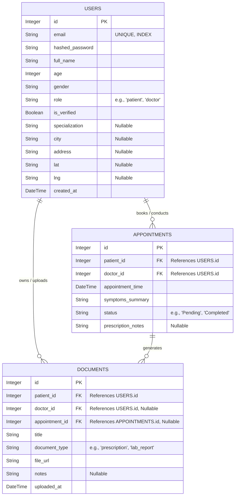

# Database Schema Documentation

This document outlines the relational database schema for the Medical Consultation Assistant. It includes an Entity-Relationship (ER) diagram followed by detailed descriptions of each table, its columns, data types, and constraints.

## Entity-Relationship (ER) Diagram

---

## Data Dictionary

### 1. `users` Table
Stores all user information, including both patients and doctors. The `role` column distinguishes the user type.

| Column Name | Data Type | Constraints | Description |
| :--- | :--- | :--- | :--- |
| **id** | Integer | Primary Key, Auto-increment | Unique identifier for the user. |
| **email** | String | Unique, Not Null, Indexed | User's email address (used for login). |
| **hashed_password**| String | Not Null | Encrypted password for authentication. |
| **full_name** | String | | The user's full legal name. |
| **age** | Integer | | Age of the user (important for medical contexts). |
| **gender** | String | | Gender of the user. |
| **role** | String | Default: 'patient' | Distinguishes between 'patient', 'doctor', or 'admin'. |
| **is_verified** | Boolean | Default: False | Indicates if the user's email or identity is verified. |
| **specialization** | String | Nullable | Medical specialization (Applicable to doctors only). |
| **city** | String | Nullable | City of practice/residence. |
| **address** | String | Nullable | Detailed street address. |
| **lat** | String | Nullable | Geographical latitude for location-based search. |
| **lng** | String | Nullable | Geographical longitude for location-based search. |
| **created_at** | DateTime | Default: Current Timestamp| Date and time the account was created. |

### 2. `appointments` Table
Manages the scheduling and details of medical consultations between patients and doctors.

| Column Name | Data Type | Constraints | Description |
| :--- | :--- | :--- | :--- |
| **id** | Integer | Primary Key, Auto-increment | Unique identifier for the appointment. |
| **patient_id** | Integer | Foreign Key (`users.id`) | Reference to the patient who booked the appointment. |
| **doctor_id** | Integer | Foreign Key (`users.id`) | Reference to the doctor conducting the consultation. |
| **appointment_time**| DateTime | Not Null | Scheduled date and time for the consultation. |
| **symptoms_summary**| String | Not Null | Brief description of the patient's symptoms/reason for visit. |
| **status** | String | Default: 'Pending' | Current state (e.g., Pending, Confirmed, Completed, Cancelled). |
| **prescription_notes**| String | Nullable | Notes or prescriptions provided by the doctor post-consultation. |

### 3. `documents` Table
Handles medical records, lab reports, prescriptions, and clinical notes uploaded to the system.

| Column Name | Data Type | Constraints | Description |
| :--- | :--- | :--- | :--- |
| **id** | Integer | Primary Key, Auto-increment | Unique identifier for the document. |
| **patient_id** | Integer | Foreign Key (`users.id`) | Reference to the patient the document belongs to. |
| **doctor_id** | Integer | Foreign Key (`users.id`), Nullable | Reference to the doctor who uploaded it (if applicable). |
| **appointment_id** | Integer | Foreign Key (`appointments.id`), Nullable | Reference to an appointment if generated during a consultation. |
| **title** | String | Indexed | Descriptive title of the document. |
| **document_type** | String | Indexed | Category (e.g., 'prescription', 'lab_report', 'x_ray'). |
| **file_url** | String | Not Null | Storage path or external URL where the file is hosted. |
| **notes** | String | Nullable | Any additional context or descriptions regarding the file. |
| **uploaded_at** | DateTime| Default: Current Timestamp| Date and time the document was uploaded. |
